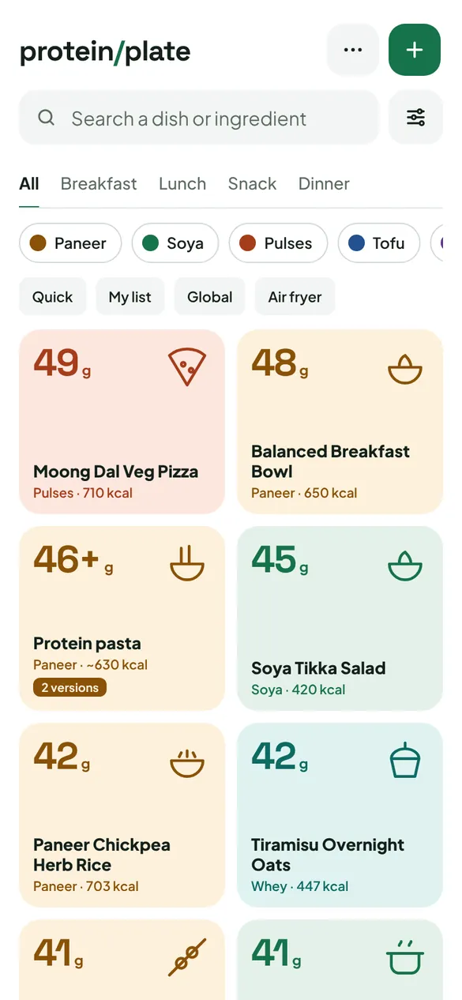
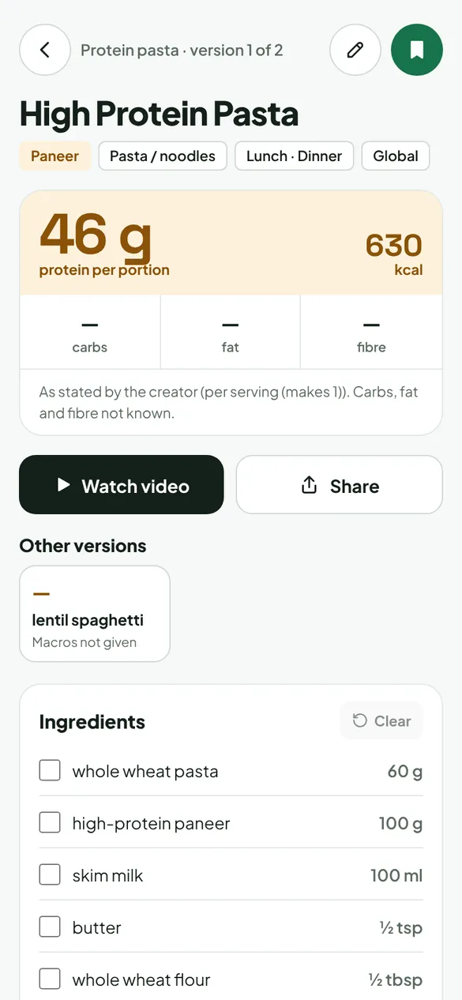
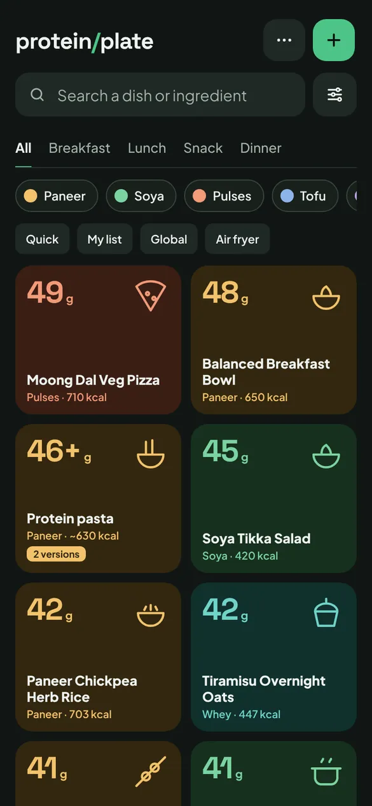
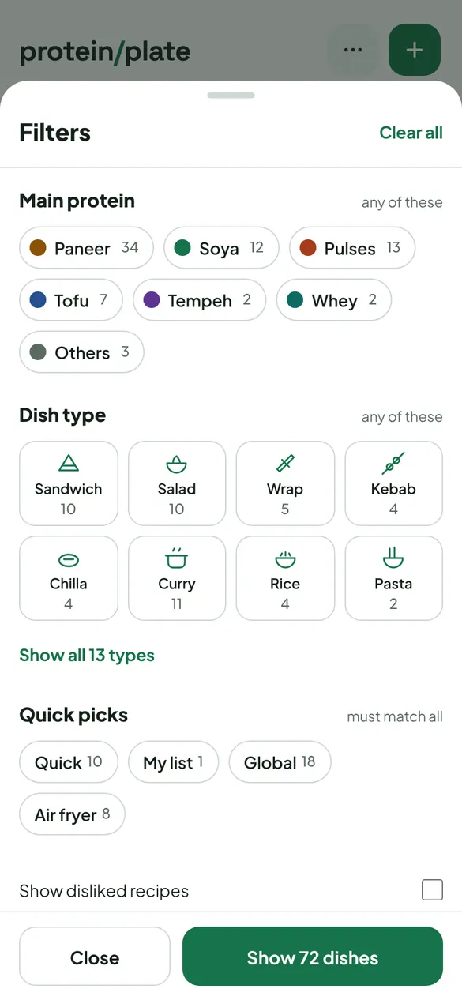
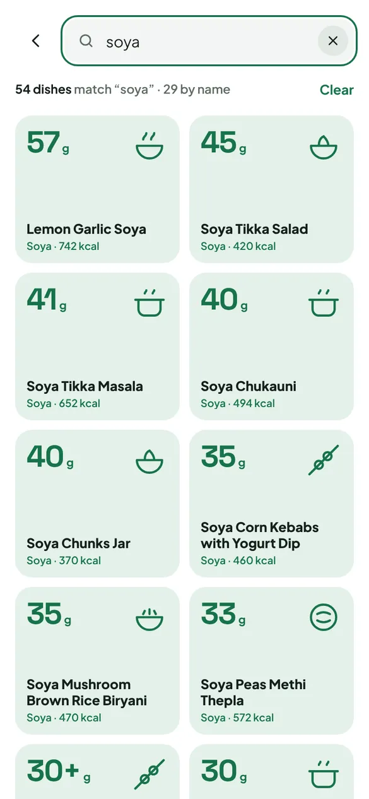
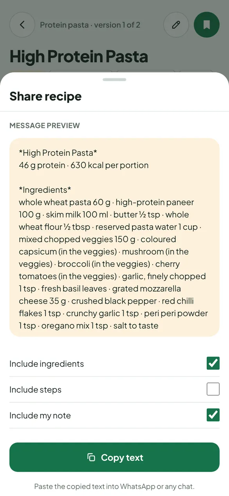
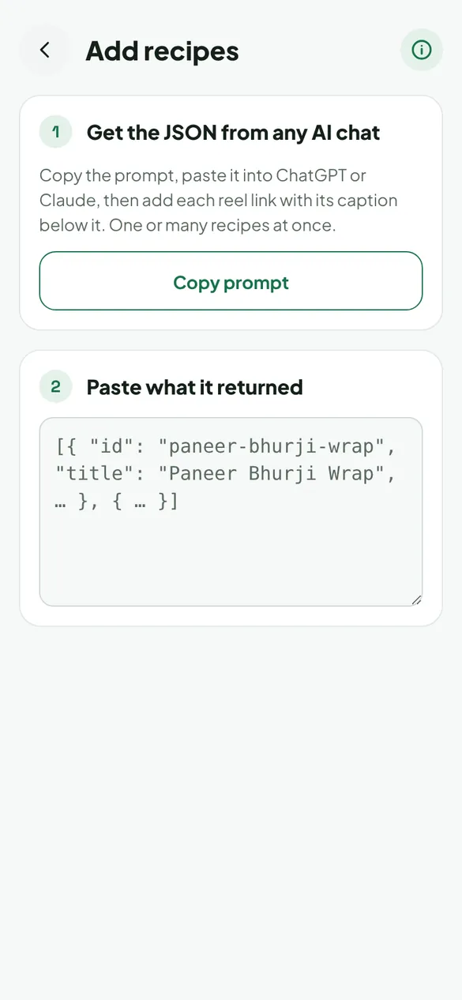
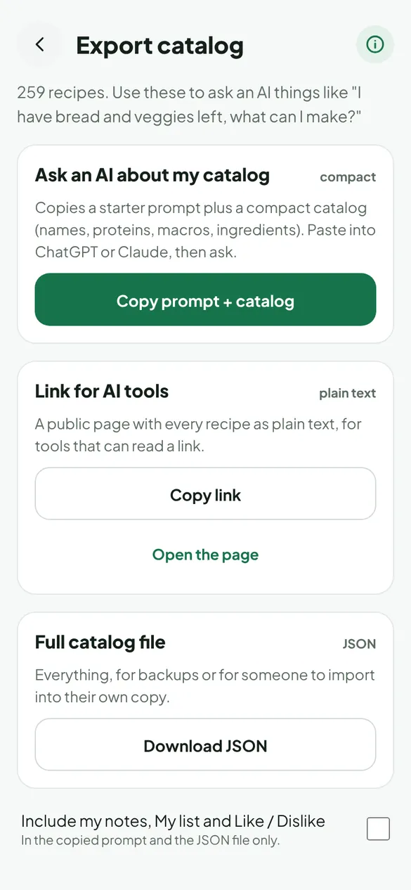
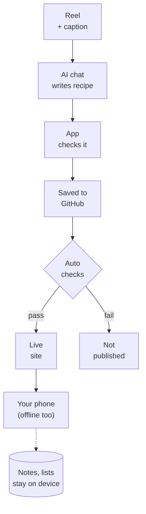

<p align="center"></p>
<h1 align="center">Protein Plate</h1>

<p align="center">
  <b>High-protein vegetarian recipes, filtered by meal and protein.</b><br>
  Free · works on your phone · works offline · no account<br>
  <b>A building block:</b> <a href="#make-it-yours">make your own copy</a> and fill it with your own recipes.
</p>

<p align="center">
  <a href="https://jatin17solanki.github.io/protein-plate/"><b>Open the app →</b></a>
</p>

<p align="center">
  &nbsp;
  &nbsp;
  
</p>

---

## Contents

- [Features](#features)
- [Make it yours](#make-it-yours)
- [Use the catalog with any AI](#use-the-catalog-with-any-ai)
- [What it's for](#what-its-for)
- [Roadmap](#roadmap)
- [How it works](#how-it-works)
- [Run your own copy](#run-your-own-copy)
- [Feedback and ideas](#feedback-and-ideas)
- [Develop](#develop)
- [Credits and licence](#credits-and-licence)

---

## Features

<table>
<tr>
<td align="center" width="33%"></td>
<td align="center" width="33%"></td>
<td align="center" width="33%"></td>
</tr>
<tr>
<td valign="top"><b>Find something to cook</b><br>Pick a meal and a protein (or leave one out), add Quick, Classics, Add-ons, Global or Air fryer. Counts show what you'll get; desserts and sauces wait at the end.</td>
<td valign="top"><b>Search the fridge</b><br>Search a dish or an ingredient. Small typos are fine.</td>
<td valign="top"><b>One page per recipe</b><br>Protein, video, ingredients to tick, steps, versions, your notes.</td>
</tr>
<tr>
<td align="center"></td>
<td align="center"></td>
<td align="center"></td>
</tr>
<tr>
<td valign="top"><b>Send it to anyone</b><br>A WhatsApp-ready message plus a link that previews as a recipe card.</td>
<td valign="top"><b>Add a recipe from a reel</b><br>Any AI chat turns the caption into a recipe; the app checks it and saves it to GitHub.</td>
<td valign="top"><b>Ask an AI what to make</b><br>"I have bread and veggies left": answers from your own recipes, with links.</td>
</tr>
</table>

**Also:** light and dark mode · install it on your Home Screen · works offline · back up and restore your notes and lists · **Send feedback** from the menu.

---

## Make it yours

This app is a **template, not a closed product**. The recipes here are mine; the app works with anyone's. Your copy is free, has no server or account, and takes about 15 minutes.

**Bring whatever recipe data you have.** It doesn't need to be tidy:

| You have… | How it gets in |
|---|---|
| Saved Instagram / YouTube reels | The app's **Add recipes** screen: copy the prompt, paste it into any AI chat with the captions, paste the answer back. |
| Notes, a WhatsApp chat, a family recipe book | Same: paste the text instead of captions. The AI turns it into recipe files. |
| A spreadsheet or another app's export | Ask an AI to convert it using the recipe format in [`schema/recipe.schema.json`](schema/recipe.schema.json). |
| Recipes already in this format | Drop the files into `data/recipes/`. |

**What you can change:**
- **Without code:** the name, your recipes, your feedback address ([`site.config.json`](#run-your-own-copy)).
- **With a coding tool** (Claude Code, Cursor, Copilot…): proteins, filters, dish types, colours, anything else. The code is MIT licensed. Point the tool at [`CLAUDE.md`](CLAUDE.md) first; [Develop](#develop) shows where everything lives.

**Stuck? Let an AI walk you through it.** These open a new chat with a ready-made prompt that reads this repo and guides you step by step:

<p>
  <a href="https://claude.ai/new?q=I%20want%20my%20own%20copy%20of%20Protein%20Plate%2C%20a%20free%20recipe-catalog%20web%20app%3A%20https%3A%2F%2Fgithub.com%2FJatin17Solanki%2Fprotein-plate%20.%20Read%20its%20README%20%28especially%20%22Make%20it%20yours%22%20and%20%22Run%20your%20own%20copy%22%29%20and%20docs%2FADD-RECIPES.md.%20I%27m%20not%20a%20developer.%20First%20ask%20me%20what%20recipe%20data%20I%20have%20%28links%2C%20notes%2C%20a%20spreadsheet%2C%20family%20recipes%E2%80%A6%29%20and%20what%20I%20want%20to%20filter%20by.%20Then%20guide%20me%20one%20step%20at%20a%20time%3A%20set%20up%20my%20copy%2C%20turn%20my%20data%20into%20the%20app%27s%20recipe%20files%2C%20and%20tell%20me%20which%20changes%20need%20a%20coding%20tool."><b>Ask Claude →</b></a>&nbsp;&nbsp;·&nbsp;&nbsp;<a href="https://chatgpt.com/?q=I%20want%20my%20own%20copy%20of%20Protein%20Plate%2C%20a%20free%20recipe-catalog%20web%20app%3A%20https%3A%2F%2Fgithub.com%2FJatin17Solanki%2Fprotein-plate%20.%20Read%20its%20README%20%28especially%20%22Make%20it%20yours%22%20and%20%22Run%20your%20own%20copy%22%29%20and%20docs%2FADD-RECIPES.md.%20I%27m%20not%20a%20developer.%20First%20ask%20me%20what%20recipe%20data%20I%20have%20%28links%2C%20notes%2C%20a%20spreadsheet%2C%20family%20recipes%E2%80%A6%29%20and%20what%20I%20want%20to%20filter%20by.%20Then%20guide%20me%20one%20step%20at%20a%20time%3A%20set%20up%20my%20copy%2C%20turn%20my%20data%20into%20the%20app%27s%20recipe%20files%2C%20and%20tell%20me%20which%20changes%20need%20a%20coding%20tool."><b>Ask ChatGPT →</b></a>
</p>

<details>
<summary>The prompt (copy it into any other AI chat)</summary>

```
I want my own copy of Protein Plate, a free recipe-catalog web app: https://github.com/Jatin17Solanki/protein-plate . Read its README (especially "Make it yours" and "Run your own copy") and docs/ADD-RECIPES.md. I'm not a developer. First ask me what recipe data I have (links, notes, a spreadsheet, family recipes…) and what I want to filter by. Then guide me one step at a time: set up my copy, turn my data into the app's recipe files, and tell me which changes need a coding tool.
```

</details>

Step-by-step instructions: [Run your own copy](#run-your-own-copy).

---

## Use the catalog with any AI

Every recipe is saved as structured data: protein and calories per portion, meal, main protein, every ingredient with its amount, the steps and the video link. So an AI can search, compare, plan and make lists from it. You don't need to be technical; pick whichever way your AI chat supports:

| | How | Works best when |
|---|---|---|
| **1. Copy and paste** | In the app: Menu → **Export catalog** → **Copy prompt + catalog**. Paste it into a new chat, then ask your question. | Always. Works in any AI chat app, on any phone. |
| **2. Share the link** | Paste [this link](https://jatin17solanki.github.io/protein-plate/catalog.txt) into the chat with your question. The AI opens it and reads every recipe. | Your AI chat can open links (most can, when web access is on). |
| **3. Upload the file** | Export catalog → **Download JSON**, then attach that file in the chat (📎). | Your AI chat takes file uploads; good for long plans. |

**Example questions:**

- **Copy and paste:**
  > *"Cook's away today and I need something quick with at least 30 g protein. Pick one."*

  The AI picks from your recipes only, says how much protein and why it fits, and ends with **"Open the recipe:"** and the link. If your question is open-ended, it first asks one or two short questions (which meal? how much time?).
- **Share the link:**
  > *"Here are my recipes: https://jatin17solanki.github.io/protein-plate/catalog.txt. Plan my breakfasts for next week, at least 25 g protein each, no paneer two days in a row."*
- **Upload the file:**
  > *(attach the file)* *"Make one shopping list for Besan Toast Breakfast Sandwich, Peri Peri Paneer Sandwich and a dal of your choice from this file."*

**More ideas:**
- A **weekly plan** that hits your daily protein, with a **shopping list**.
- Save the link once in a ChatGPT custom GPT or a Claude Project, so every chat there already knows your recipes.
- "What can I make with what's in my fridge?" Type what you have and let it match.

Your notes, list and likes aren't in the public link. To include them in the copied prompt or the file, tick *Include my notes…* on the Export screen first.

<details>
<summary>For developers: the JSON feed</summary>

The same catalog is published as JSON at [`catalog.json`](https://jatin17solanki.github.io/protein-plate/catalog.json), for scripts, automations, spreadsheets or your own app. Quick breakfasts with at least 25 g protein:

```sh
curl -s https://jatin17solanki.github.io/protein-plate/catalog.json \
  | jq -r '.recipes[]
      | select(.tags | index("quick")) | select(.meal_types.values | index("breakfast"))
      | select(.per_portion.protein_g >= 25)
      | "\(.per_portion.protein_g) g  \(.title)"' | sort -rn
```
```
45 g  Chocolate Greek Yogurt Bowl with Strawberries and Muesli
40 g  Peri Peri Paneer Sandwich
40 g  Iced Coffee Protein Smoothie
35 g  Besan Toast Breakfast Sandwich
…
```

</details>

---

## What it's for

| Situation | What helps |
|---|---|
| "What do we make for breakfast?" | Meal tabs, highest protein first |
| "Had paneer yesterday, want something else" | Protein chips, **Leave out**, dish types, versions |
| "Something familiar, but with more protein" | **Classics** (Soya Poha, Protein Upma…) |
| "Plain dal-roti today, need more protein" | **Add-ons** (a quick protein side) |
| "Something quick" / "I have curd and 20 minutes" | Quick, Air fryer, ingredient search |
| "Something different tonight" | Global (fusion, non-Indian) |
| "My go-to recipes" | My list, likes, notes |
| "Send this to Mom" | Share to WhatsApp |
| "Saw a great reel" | Add recipes |
| "Cook didn't come, I have leftovers" | Ask an AI with Export |

---

## Roadmap

| ✅ Now (v1) | 🔜 Next (v2) | 🚫 Not planned |
|---|---|---|
| Browse, filter, search | Desserts and sauces last in every list; **Leave out** a protein | Accounts or sign-in |
| Recipe page, versions, notes | **Classics**: everyday Indian dishes made high-protein | Servers or paid services |
| My list, like / dislike | **Add-ons**: a protein side for any plain meal | Ads or tracking |
| Share, add recipes, ask an AI | More quick, light snacks for every protein | Meal planning inside the app |
| Offline, Home Screen, dark mode | | |

Full list of later ideas: [backlog](docs/CONTEXT.md#11-backlog-v2-and-later--keep-dont-build-yet).

---

## How it works



- **No server, no database.** Each recipe is one file in this repository. The site is built from those files and hosted free on GitHub Pages.
- **Nothing broken goes live.** Every change is checked automatically: recipe format, tests on 9 screen sizes in light and dark, and accessibility. If anything fails, the site stays as it was.
- **Your data stays with you.** Notes, lists and likes live in your browser. Move them with Back up / Restore.

<details>
<summary>Tech stack and key decisions</summary>

- Vite · TypeScript · Preact · a service worker for offline use · Playwright and Vitest for tests · GitHub Actions.
- Recipes must match [`schema/recipe.schema.json`](schema/recipe.schema.json). Ingredients are listed exactly as in the source.
- Each recipe gets its own page and preview image at build time, so shared links show a card.
- AI is used only through chats you already have, never through a paid API.
- All decisions are dated in [`docs/DECISIONS.md`](docs/DECISIONS.md). The app and the data were built by Claude Code sessions working in two lanes; see [`CLAUDE.md`](CLAUDE.md).

</details>

---

## Run your own copy

**This site is my personal catalog.** Anyone can use it, and your notes, list and likes stay private on your device. But you can't add recipes to it; you can only suggest them.

**Your own copy is yours:**
- **Your recipes:** the reels *you* save, the dishes your family eats, the creators you follow. Add one from your phone in a minute.
- **Your rules:** rename it in one config file, keep only what you cook, and change anything else in the code (it's MIT licensed).
- **Your AI workflows** run on your own list (see [Use the catalog with any AI](#use-the-catalog-with-any-ai)).
- **Your feedback inbox:** "Send feedback" goes to you, not me.
- **Free and independent:** no server, no account, no bill. If this repo disappears, your copy keeps working.

You need a free GitHub account. It takes about 15 minutes.

1. **Fork** this repository.
2. In your fork: **Settings → Pages → Source: GitHub Actions**.
3. Edit **`site.config.json`** with your name, repo and address (see below).
4. Keep the recipes, or replace the files in `data/recipes/` with your own, added through the app's **Add recipes** screen.
5. Commit. About 2 minutes later your site is live.
6. *Optional:* protect `main` with the two rulesets in [`.github/rulesets/`](.github/rulesets/) (one-minute import).

<details>
<summary><code>site.config.json</code></summary>

```json
{
  "title": "Protein Plate",
  "description": "High-protein vegetarian recipes, filtered by meal, protein and dish type.",
  "owner": "your-github-name",
  "repo": "your-repo-name",
  "branch": "main",
  "site_url": "https://your-github-name.github.io/your-repo-name/",
  "base_path": "/your-repo-name/",
  "feedback_email": "you@example.com"
}
```

- `owner` / `repo`: where "Edit", "Add recipes" and GitHub feedback point.
- `feedback_email`: where "Send feedback → Email" goes. It's public. Leave it empty for GitHub issues only.
- `base_path`: use `/` for a custom domain.

</details>

---

## Feedback and ideas

Found something wrong, or have an idea for a feature? I'd love to hear it.

- **In the app:** Menu → **Send feedback**, or the link at the bottom of any recipe. It fills in the page and your device for you.
- **Email:** [jatin.dev.17@gmail.com](mailto:jatin.dev.17@gmail.com?subject=Protein%20Plate%20feedback)
- **GitHub:** [open an issue](https://github.com/Jatin17Solanki/protein-plate/issues/new?labels=feedback&title=Protein%20Plate%20feedback) (public; needs a free account)

---

## Develop

Needs Node 22+.

```sh
npm ci
npm run dev          # local site
npm test             # unit tests
npm run test:e2e     # browser tests: 9 screen sizes, light + dark, accessibility
npm run validate     # check every recipe file
```

<details>
<summary>Folder map and more commands</summary>

| Folder | What's inside |
|---|---|
| `src/` | the app |
| `data/recipes/` | one JSON file per recipe |
| `schema/` | the recipe format |
| `prompts/` | the AI prompts the app copies |
| `tests/` | unit and browser tests |
| `docs/` | plan, decisions, design, manual test |

```sh
VITE_FIXTURES=1 npm run dev   # run with the 10 test recipes
npm run gen:types             # after changing the schema
npm run icons                 # after changing the logo
```

New here, or an AI session? Start with [`CLAUDE.md`](CLAUDE.md).

</details>

---

## Credits and licence

Recipes come from public posts by their original authors. Every recipe credits its author and links to the original video. To change or remove one, use **Send feedback** in the app.

- **Code:** MIT, see [`LICENSE`](LICENSE).
- **Recipes and videos:** belong to their authors. They are not covered by the MIT licence.

