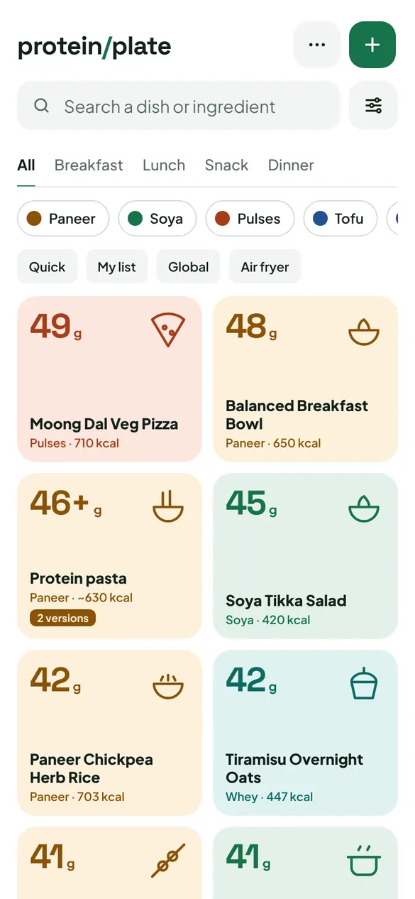
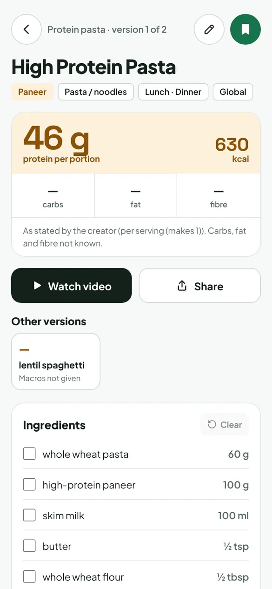
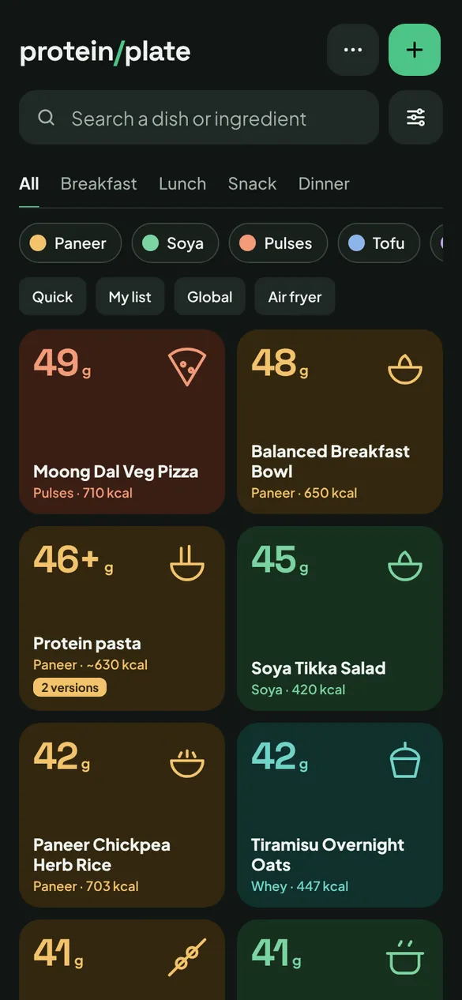
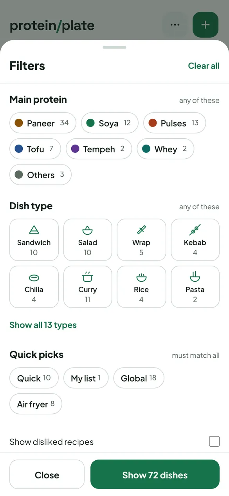
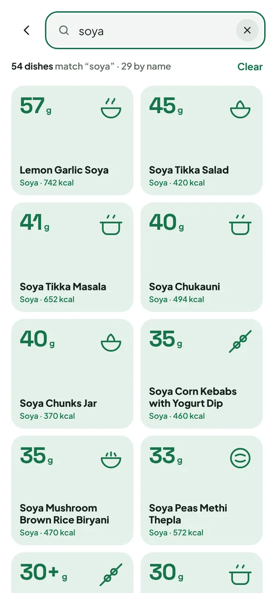
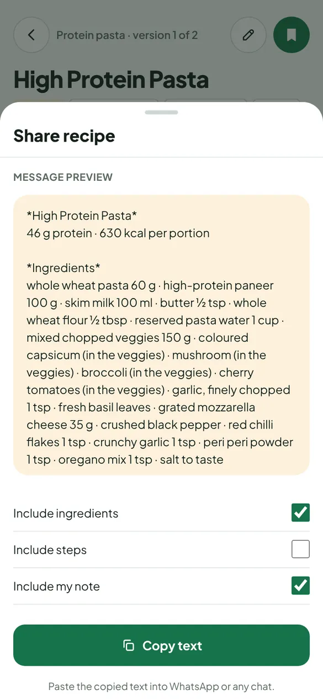
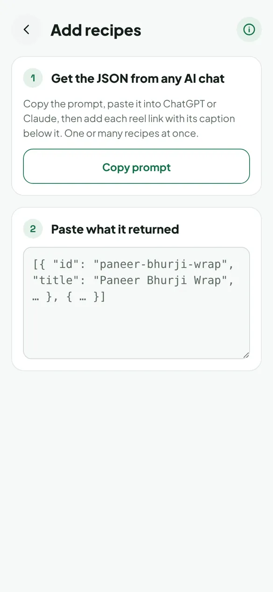
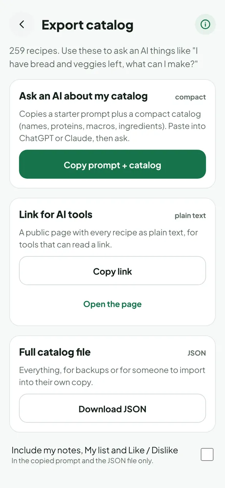
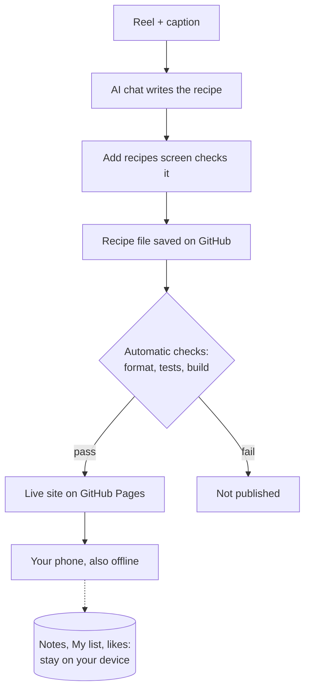

<p align="center"></p>
<h1 align="center">Protein Plate</h1>

<p align="center">
  <b>High-protein vegetarian recipes, filtered by meal and protein.</b><br>
  Free · works on your phone · works offline · no account
</p>

<p align="center">
  <a href="https://jatin17solanki.github.io/protein-plate/"><b>Open the app →</b></a>
</p>

<p align="center">
  &nbsp;
  &nbsp;
  
</p>

---

## Contents

- [Features](#features)
- [What it's for](#what-its-for)
- [Roadmap](#roadmap)
- [How it works](#how-it-works)
- [Run your own copy](#run-your-own-copy)
- [Develop](#develop)
- [Credits and licence](#credits-and-licence)

---

## Features

<table>
<tr>
<td align="center" width="33%"></td>
<td align="center" width="33%"></td>
<td align="center" width="33%"></td>
</tr>
<tr>
<td valign="top"><b>Find something to cook</b><br>Pick a meal and a protein, add Quick, Global or Air fryer. Counts show what you'll get.</td>
<td valign="top"><b>Search the fridge</b><br>Search a dish or an ingredient. Small typos are fine.</td>
<td valign="top"><b>One page per recipe</b><br>Protein, video, ingredients to tick, steps, versions, your notes.</td>
</tr>
<tr>
<td align="center"></td>
<td align="center"></td>
<td align="center"></td>
</tr>
<tr>
<td valign="top"><b>Send it to anyone</b><br>A WhatsApp-ready message plus a link that previews as a recipe card.</td>
<td valign="top"><b>Add a recipe from a reel</b><br>Any AI chat turns the caption into a recipe; the app checks it and saves it to GitHub.</td>
<td valign="top"><b>Ask an AI what to make</b><br>"I have bread and veggies left": answers from your own recipes, with links.</td>
</tr>
</table>

**Also:** light and dark mode · install it on your Home Screen · works offline · back up and restore your notes and lists · **Send feedback** from the menu.

---

## What it's for

| Situation | What helps |
|---|---|
| "What do we make for breakfast?" | Meal tabs, highest protein first |
| "Had paneer yesterday, want something else" | Protein chips, dish types, versions |
| "Something quick" / "I have curd and 20 minutes" | Quick, Air fryer, ingredient search |
| "Something different tonight" | Global (fusion, non-Indian) |
| "My go-to recipes" | My list, likes, notes |
| "Send this to Mom" | Share to WhatsApp |
| "Saw a great reel" | Add recipes |
| "Cook didn't come, I have leftovers" | Ask an AI with Export |

---

## Roadmap

| ✅ Now (v1) | 🔜 Next (v2) | 🚫 Not planned |
|---|---|---|
| Browse, filter, search | **Meal plan** for a day or week, with protein totals | Accounts or sign-in |
| Recipe page, versions, notes | **Rotation builder**: 1–2 weeks that hit a daily protein target | Servers or paid services |
| My list, like / dislike | "Last planned" markers, to avoid repeats | Ads or tracking |
| Share, add recipes, ask an AI | Shopping list for the week | |
| Offline, Home Screen, dark mode | Suggestions for something new to try | |

More in [`docs/CONTEXT.md` § Backlog](docs/CONTEXT.md).

---

## How it works



- **No server, no database.** Each recipe is one file in this repository. The site is built from those files and hosted free on GitHub Pages.
- **Nothing broken goes live.** Every change is checked automatically: recipe format, tests on 9 screen sizes in light and dark, and accessibility. If anything fails, the site stays as it was.
- **Your data stays with you.** Notes, lists and likes live in your browser. Move them with Back up / Restore.

<details>
<summary>Tech stack and key decisions</summary>

- Vite · TypeScript · Preact · a service worker for offline use · Playwright and Vitest for tests · GitHub Actions.
- Recipes must match [`schema/recipe.schema.json`](schema/recipe.schema.json). Ingredients are listed exactly as in the source.
- Each recipe gets its own page and preview image at build time, so shared links show a card.
- AI is used only through chats you already have, never through a paid API.
- All decisions are dated in [`docs/DECISIONS.md`](docs/DECISIONS.md). The app and the data were built by Claude Code sessions working in two lanes; see [`CLAUDE.md`](CLAUDE.md).

</details>

---

## Run your own copy

You need a free GitHub account. It takes about 15 minutes.

1. **Fork** this repository.
2. In your fork: **Settings → Pages → Source: GitHub Actions**.
3. Edit **`site.config.json`** with your name, repo and address (see below).
4. Keep the recipes, or replace the files in `data/recipes/` with your own, added through the app's **Add recipes** screen.
5. Commit. About 2 minutes later your site is live.

<details>
<summary><code>site.config.json</code></summary>

```json
{
  "title": "Protein Plate",
  "description": "High-protein vegetarian recipes, filtered by meal, protein and dish type.",
  "owner": "your-github-name",
  "repo": "your-repo-name",
  "branch": "main",
  "site_url": "https://your-github-name.github.io/your-repo-name/",
  "base_path": "/your-repo-name/",
  "feedback_email": "you@example.com"
}
```

- `owner` / `repo`: where "Edit", "Add recipes" and GitHub feedback point.
- `feedback_email`: where "Send feedback → Email" goes. It's public. Leave it empty for GitHub issues only.
- `base_path`: use `/` for a custom domain.

</details>

---

## Develop

Needs Node 22+.

```sh
npm ci
npm run dev          # local site
npm test             # unit tests
npm run test:e2e     # browser tests: 9 screen sizes, light + dark, accessibility
npm run validate     # check every recipe file
```

<details>
<summary>Folder map and more commands</summary>

| Folder | What's inside |
|---|---|
| `src/` | the app |
| `data/recipes/` | one JSON file per recipe |
| `schema/` | the recipe format |
| `prompts/` | the AI prompts the app copies |
| `tests/` | unit and browser tests |
| `docs/` | plan, decisions, design, manual test |

```sh
VITE_FIXTURES=1 npm run dev   # run with the 10 test recipes
npm run gen:types             # after changing the schema
npm run icons                 # after changing the logo
```

New here, or an AI session? Start with [`CLAUDE.md`](CLAUDE.md).

</details>

---

## Credits and licence

Recipes come from public posts by their original authors. Every recipe credits its author and links to the original video. To change or remove one, use **Send feedback** in the app.

- **Code:** MIT, see [`LICENSE`](LICENSE).
- **Recipes and videos:** belong to their authors. They are not covered by the MIT licence.

**Feedback:** use **Send feedback** in the app menu, or [open an issue](https://github.com/Jatin17Solanki/protein-plate/issues/new).
